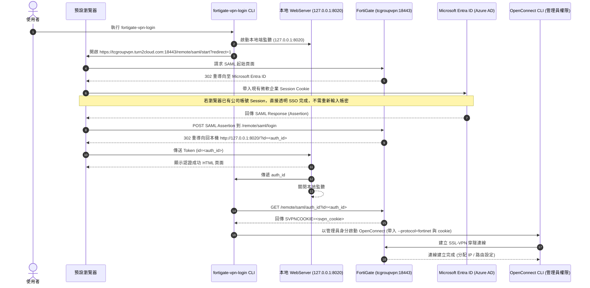

# FortiGate SAML VPN (Windows 11) 疑難排解與架構技術手冊

本手冊記錄在 Windows 11 環境下使用 `fortigate-vpn-login` 搭配 OpenConnect 進行 FortiGate SAML SSL-VPN 連線時所遭遇的所有問題、根本原因分析（Root Cause）、修復方案以及 SAML SSO 認證流程剖析。

---

## 1. 系統架構與 SAML SSO 認證生命週期

`fortigate-vpn-login` 是一個專門用來簡化 FortiGate SAML (Single Sign-On) 認證並轉接給 OpenConnect 建立 SSL-VPN 穿隧的輔助工具。

### 1.1 核心流程時序圖



---

## 2. 遭遇問題與修復紀錄 (Issue & Fixes)

### 錯誤一：`AttributeError: 'Namespace' object has no attribute 'foreground'` 與 `os.uname` 崩潰

#### 1. 錯誤訊息
```text
Traceback (most recent call last):
  File "D:\_Lab-Github\fortigate-vpn-login\fortigate_vpn_login\cli.py", line 178, in main
    if parser.foreground:
AttributeError: 'Namespace' object has no attribute 'foreground'
```
以及隨後的：
```text
AttributeError: module 'os' has no attribute 'uname'
```

#### 2. 根本原因 (Root Cause)
- **參數註冊缺失**：原作者在 `argparse` 中限制了只有在非 Windows 系統 (`if not utils.is_windows():`) 下才會註冊 `-F` / `--foreground` 與 `-B` / `--background` 選項。然而在主程式判斷時，卻直接存取了 `parser.foreground`，導致 Windows 環境下解析器物件找不到該屬性而拋出 `AttributeError`。
- **Unix 專屬 API**：在組裝 User-Agent 字串時，呼叫了 `os.uname().version`。但 `os.uname()` 為 POSIX 專屬函式，在 Windows Python 上並不存在。

#### 3. 修復方式
- 在 `cli.py` 中替解析器設定全域預設值：
  ```python
  parser.set_defaults(FOREGROUND=False, BACKGROUND=False)
  ```
- 改用安全的 `getattr` 讀取參數屬性：
  ```python
  if getattr(parser, 'FOREGROUND', False): ...
  ```
- 引入 Python 標準庫 `platform`，改用跨平台的 `platform.uname().version` 取代 `os.uname().version`。

---

### 錯誤二：OpenConnect 執行檔偵測失敗（「版本不相容」誤報）

#### 1. 錯誤訊息
```text
ERROR: Your openconnect version isn't compatible with this program. Make sure you have the latest version, which supports the "fortinet" protocol.
```

#### 2. 根本原因 (Root Cause)
- **路徑搜尋未命中**：原本的 `find_openconnect()` 僅檢查 Windows 系統 `PATH` 以及固定的 Linux/macOS 路徑，未能找到安裝於 `C:\ProgramFiles\OpenConnect-GUI` 或 `C:\Program Files\OpenConnect-GUI` 的 `openconnect.exe`。
- **錯誤訊息混淆**：當 `find_openconnect()` 回傳 `None` 時，程式未先檢查是否找到檔案，就直接將 `None` 傳入 `check_openconnect_version(None)`。此函式呼叫失敗後直接印出「您的版本不相容，請確認支援 fortinet 協定」，導致使用者誤以為已安裝的 OpenConnect 版本太舊，實則是「根本沒找到執行檔路徑」。

#### 3. 修復方式
- 在 `utils.py` 中重寫 `find_openconnect()`，加入深度的 Windows 搜尋邏輯：
  1. 優先搜尋常見預設路徑：
     - `C:\ProgramFiles\OpenConnect-GUI\openconnect.exe`
     - `C:\Program Files\OpenConnect-GUI\openconnect.exe`
     - `C:\Program Files (x86)\OpenConnect-GUI\openconnect.exe`
  2. 自動查詢 Windows 註冊表（Registry）的解除安裝機碼：
     - `HKLM\SOFTWARE\Microsoft\Windows\CurrentVersion\Uninstall`
     - `HKCU\Software\Microsoft\Windows\CurrentVersion\Uninstall`
     - `HKLM\SOFTWARE\WOW6432Node\Microsoft\Windows\CurrentVersion\Uninstall`
     自動解析 `OpenConnect-GUI` 的 `InstallLocation`。
- 分離檢查邏輯：
  - 若 `openconnect_path is None`，明確提示：`"ERROR: OpenConnect executable not found. Please install OpenConnect or add it to PATH."`
  - 若找到路徑但版本未支援 `fortinet`，才提示版本不相容。

---

### 錯誤三：URL 協定缺失引發 `InvalidSchema` 例外

#### 1. 錯誤訊息
```text
requests.exceptions.InvalidSchema: No connection adapters were found for 'tcgroupvpn.turn2cloud.com:18443/remote/saml/start?redirect=1'
```

#### 2. 根本原因 (Root Cause)
- 使用者在初次設定或 `config.ini` 中填寫 VPN 伺服器網址為 `tcgroupvpn.turn2cloud.com:18443`。
- 由於字串開頭缺少 `https://`，Python 的 `requests` 模組無法判定網路通訊協定，因而擲出 `InvalidSchema` 異常中斷。

#### 3. 修復方式
- 在 `Fortigate.__init__` 與 `config.py` 加入 URL 自動正規化（Auto-normalization）：
  ```python
  if url:
      url = url.strip()
      if not url.startswith("http://") and not url.startswith("https://"):
          url = f"https://{url}"
      url = url.rstrip("/")
  ```
- 同步修正使用者設定檔 `%APPDATA%\fortigate_vpn_login\config.ini`：
  ```ini
  [CONFIG]
  forti_url = https://tcgroupvpn.turn2cloud.com:18443
  ```
- 擴大例外捕捉範圍，在連線時捕捉 `(MissingSchema, InvalidSchema, InvalidURL, RequestException)` 並輸出友善提示。

---

### 現象剖析四：瀏覽器打開後「沒有輸入帳密位置」與 SAML 端點行為差異

#### 1. 使用者反饋現象
> - 「網頁有打開 `https://tcgroupvpn.turn2cloud.com:18443/remote/saml/login` 但是沒有輸入帳密位置」
> - 「`https://tcgroupvpn.turn2cloud.com:18443/remote/saml/start?redirect=1` 會跳轉 `http://127.0.0.1:8020/?id=...`」
> - 「`https://tcgroupvpn.turn2cloud.com:18443/remote/saml/login` 卻不會跳轉」

#### 2. 機制與根本原因 (Root Cause)

##### (1) 為何沒有輸入帳密？
- **這是正常且預期的 Single Sign-On (SSO) 行為**。
- 此 FortiGate VPN 端點已整合 **Microsoft Entra ID (Azure AD)** 作為 SAML 身分識別提供者 (Identity Provider, IdP)。
- 當程式開啟瀏覽器時，瀏覽器跟隨重新導向至微軟登入伺服器 (`login.microsoftonline.com`)。
- 由於使用者的預設瀏覽器平時已登入公司微軟 365 帳號（保留了微軟 SSO Session Cookie），Entra ID 偵測到現有憑證合法有效，**直接發放 SAML 斷言並自動導回 FortiGate，完全不需要再次手動鍵入帳號密碼**。

##### (2) 為什麼由程式開啟會卡在 `/remote/saml/login`，而手動輸入 `/remote/saml/start?redirect=1` 就能正常跳轉？
這是 SAML 工作階段（Session Context）綁定機制的關鍵核心：

- **原程式缺陷**：
  原版程式在 `fortigate.py` 透過 Python 的 `requests.get` 去存取 `https://.../remote/saml/start?redirect=1`，抓出 HTML 中的微軟登入網址後，再呼叫瀏覽器開啟微軟頁面。
  這導致**瀏覽器本身從未造訪過 FortiGate 的 start 頁面**，因此使用者的瀏覽器內完全沒有 FortiGate 核發的 Session Cookie。當微軟完成驗證並 POST 回 `/remote/saml/login` 時，FortiGate 判定瀏覽器缺乏前置 Session，便停留在 `/remote/saml/login`，**不會**將瀏覽器導向 `127.0.0.1:8020`。
- **手動開啟成功的原因**：
  若由瀏覽器直接開啟 `https://.../remote/saml/start?redirect=1`，瀏覽器自身會向 FortiGate 建立合法工作階段 Cookie，隨後順利走完微軟 SSO 並 POST 回 FortiGate，FortiGate 識別出瀏覽器 Session，即能成功 302 跳轉至 `http://127.0.0.1:8020/?id=...`。
- **程式碼修復**：
  將 `cli.py` 修改為直接以 `webbrowser.open(f"{fortigate.url}/remote/saml/start?redirect=1")` 作為瀏覽器起始頁，使整個流程皆在同一瀏覽器環境下完成。

---

### 現象剖析五：重新導向 `http://127.0.0.1:8020/?id=...` 與 Token 兌換

#### 1. 現象與運作原理
- 當 Microsoft Entra ID 認證完成後，FortiGate 收到 SAML 回應，產生了一組暫時性驗證代碼（例如 `id=2-e1d4344177672c6c-P0nOixuS5dzRTZqJ`），並將瀏覽器 302 重導向回：
  ```text
  http://127.0.0.1:8020/?id=2-e1d4344177672c6c-P0nOixuS5dzRTZqJ
  ```
- 此時，`fortigate-vpn-login` 於背景執行的 Werkzeug 本地微型伺服器（監聽 `127.0.0.1:8020`）接收到該請求，從 URL 參數中擷取出 `auth_id`。
- 本地伺服器回傳 `"Token successfully captured"` 網頁後安全關閉。
- CLI 緊接著向 FortiGate 發起請求：
  ```http
  GET https://tcgroupvpn.turn2cloud.com:18443/remote/saml/auth_id?id=<auth_id>
  ```
  FortiGate 驗證通過後，在回應 Header 或 Body 中核發真正的 VPN 階段 Session Cookie：
  ```text
  SVPNCOOKIE=<長度極長的連線 Cookie>
  ```

---

### 現象剖析六：「黑色視窗閃一下就沒了」與視窗閃退修復

#### 1. 使用者反饋現象
> 「Waiting for the token... 跳出 黑色視窗 閃一下 就沒了」

#### 2. 根本原因 (Root Cause)
1. **Windows 控制台子程序生命週期**：
   原程式在 Windows 上使用 PowerShell 的 `Start-Process '{openconnect_path}' ... -Verb runAs` 直接呼叫 `openconnect.exe`。
   在 Windows 的機制中，當子程序執行完成（不管是成功中斷、證書被拒絕，或是因故退出）時，**Windows 會立即自動銷毀該命令提示字元視窗**，導致使用者只能看到黑畫面閃過，完全無法看到錯誤訊息。
2. **參數傳遞跳脫截斷**：
   SAML 所產生的 `SVPNCOOKIE` 非常長且包含特殊的符號（如 `+`、`/`、`=` 等），直接以 PowerShell 字串插入 `-ArgumentList` 時，容易遭受引號解析錯誤。
3. **Cookie 狀態或模式不符**：
   若重複執行或 Cookie 過期，FortiGate 會直接回應：
   `Logout successful. Cookie was rejected by server; exiting.`
   此時 OpenConnect 退出碼非 0，視窗立刻關閉。

#### 3. 修復方案：暫存批次檔封裝與 `pause` 防閃退
在 `fortigate_vpn_login/cli.py` 中，將 Windows 啟動 OpenConnect 的方式改良為動態建立暫存批次檔 runner：
```python
if utils.is_windows():
    import tempfile
    workdir = openconnect_path.parent
    bat_file = Path(tempfile.gettempdir()) / "fortigate_vpn_run.bat"
    escaped_args = " ".join([f'"{arg}"' for arg in openconnect_arguments])
    bat_content = (
        "@echo off\r\n"
        "title FortiGate OpenConnect VPN\r\n"
        f'"{str(openconnect_path)}" {escaped_args}\r\n'
        "echo.\r\n"
        "echo OpenConnect process has exited.\r\n"
        "pause\r\n"
    )
    bat_file.write_text(bat_content, encoding="utf-8")
    command_line = [
        "powershell",
        "-Command",
        f"Start-Process cmd.exe -ArgumentList '/c',\"{str(bat_file)}\" -Verb runAs -WorkingDirectory '{workdir}'",
    ]
```

**效益**：
- 以系統管理員權限啟動後，即使 OpenConnect 斷線或回傳錯誤，視窗會停在 `pause`（「請按任意鍵繼續...」），使用者能清楚檢視所有 OpenConnect 連線除錯訊息（例如路由衝突、憑證問題、TUN 介面設定等）。

---

### 現象剖析七：Wintun 介面衝突 (`Failed to register rings: Code 0x000004DF`)

#### 1. 錯誤訊息
```text
2: Failed to register rings: (Code 0x000004DF)
Failed to create Wintun session: 初始化完成後，還嘗試執行初始化操作。
Set up tun device failed
GET https://tcgroupvpn.turn2cloud.com:18443/remote/logout
Logout successful.
Cookie was rejected by server; exiting.
```

#### 2. 根本原因 (Root Cause)
1. **Wintun 環形緩衝區（Ring Buffers）鎖定**：
   - 錯誤代碼 `0x000004DF` (1247) 為 Windows 系統的 `ERROR_ALREADY_INITIALIZED`（初始化完成後，還嘗試執行初始化操作）。
   - 在 WireGuard Wintun 核心驅動架構中，當一個介面卡物件已有行程連線註冊了 Ring Buffers（例如系統中正運行著 Tailscale、WireGuard，或前次非正常關閉殘留的 Wintun 介面），嘗試對相同介面呼叫 `WintunStartSession` 就會遭遇此錯誤。
2. **Cookie 被連鎖作廢**：
   - 當 TUN 虛擬網卡初始化失敗（`Set up tun device failed`）時，OpenConnect 會主動向 FortiGate 送出 `GET /remote/logout` 中斷階段，導致剛剛兌換的 `SVPNCOOKIE` 立刻被 FortiGate 作廢。若隨後重複連線，就會看到 `Cookie was rejected by server`。

#### 3. 解決方式
1. **指定專屬介面名稱**：
   在 `cli.py` 的 OpenConnect 參數中加入 `--interface=vpn0`，確保建立全新的專屬虛擬介面卡，避免與預設或現有網卡衝突。
2. **排查並暫停背景其他 Wintun 軟體**：
   若系統同時運行使用 Wintun 驅動的 VPN（如 Tailscale 或 WireGuard），可先暫停或退出該程式後再行連線。

---

## 3. 修改程式碼檔案清單

| 檔案路徑 | 主要修改內容 |
| :--- | :--- |
| `fortigate_vpn_login/cli.py` | 1. 補齊 `FOREGROUND`/`BACKGROUND` 預設參數與安全讀取<br>2. 替換 `os.uname()` 為跨平台的 `platform.uname()`<br>3. 分離 OpenConnect 路徑存在性與版本檢測<br>4. 新增 SVPNCOOKIE 空值檢查<br>5. 補齊 `from pathlib import Path` 匯入<br>6. 修正以 `/remote/saml/start?redirect=1` 作為瀏覽器起始網址<br>7. Windows 平台加入 `--interface=vpn0` 避免網卡衝突<br>8. 實作 Windows 批次檔 Runner 與 `pause` 防閃退機制 |
| `fortigate_vpn_login/utils.py` | 1. 重構 `find_openconnect()`，加入 Windows 常見路徑掃描與 Registry 查詢<br>2. `check_openconnect_version()` 增加 None 安全防護 |
| `fortigate_vpn_login/fortigate.py` | 1. URL 初始化時自動補齊 `https://` 並移除結尾斜線<br>2. 擴大連線錯誤攔截至 `InvalidSchema` 與 `MissingSchema` |
| `fortigate_vpn_login/config.py` | 互動式輸入 VPN 網址時自動規格化 URL |

---

## 4. 日常維護與手動除錯指令

### 4.1 檢查設定檔路徑與內容
設定檔存放於 Windows 使用者目錄：
```powershell
Get-Content "$env:APPDATA\fortigate_vpn_login\config.ini"
```
正確內容範例：
```ini
[CONFIG]
forti_url = https://tcgroupvpn.turn2cloud.com:18443
```

### 4.2 檢查 OpenConnect 執行檔與版本支援
```powershell
& "C:\ProgramFiles\OpenConnect-GUI\openconnect.exe" --version
```
輸出中必須包含 `--protocol=fortinet` 支援。

### 4.3 執行 VPN 登入
在虛擬環境或終端機中執行：
```powershell
fortigate-vpn-login
```
如需詳細日誌，可附加 `--debug`：
```powershell
fortigate-vpn-login --debug
```

### 4.4 結束 / 中斷 VPN 連線方式

#### 方式一：使用指令一鍵中斷（最推薦）
在任何終端機輸入：
```powershell
fortigate-vpn-login -k
# 或
fortigate-vpn-login --disconnect
```

#### 方式二：在 OpenConnect 控制台視窗中按下 `Ctrl + C`（標準優雅登出）
點選標題為 `FortiGate OpenConnect VPN` 的黑色命令提示字元視窗，按下快捷鍵 <kbd>Ctrl</kbd> + <kbd>C</kbd>。
- OpenConnect 會捕捉該中斷訊號，向 FortiGate 伺服器發送 `GET /remote/logout` 正式註銷會話。
- 自動透過 `vpnc-script-win.js` 清除與還原 VPN 路由和 DNS。
- 看到 `OpenConnect process has exited. Press any key to continue . . .` 後按下任意鍵或關閉視窗即可。

#### 方式三：使用 PowerShell 或 CMD 指令強制終止
若視窗已最小化或隱藏，可直接在終端機強制終止行程：
```powershell
# PowerShell
Stop-Process -Name openconnect -Force
```
或
```cmd
:: Command Prompt
taskkill /F /IM openconnect.exe
```
